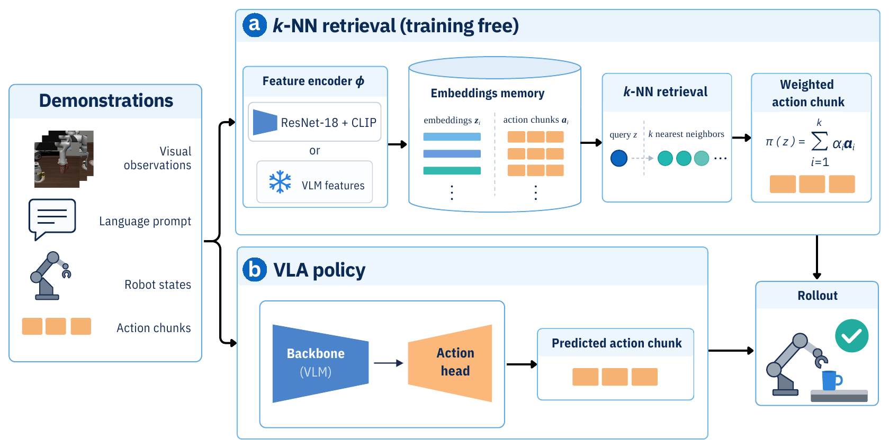

# How Much of Your VLA is kNN

[](https://sereact.github.io/lerobot_knn/)
[](https://sereact.github.io/lerobot_knn/static/pdfs/how_much_of_your_vla_is_knn.pdf)
[](LICENSE)



> **How Much of Your VLA is kNN**\
> Denis Grachev, Damien LaRocque, Omar Moured\
> Project page: https://sereact.github.io/lerobot_knn/

This repo contains the source code of our paper _How Much of Your VLA is kNN_, presented at the CoRL 2026 Workshop on
The Action Gap: Large Generative Models Learn Rich Knowledge.

We retrieve the nearest demonstration frames and replay their action chunks, without training anything. We do not
propose k-NN for robot control. We use it as a probe that answers three questions about a benchmark and a
vision-language-action model (VLA):

1. **How hard is the task?** Whatever a lookup over generic image features solves is retrieval, not generalization.
2. **How good is a VLA's backbone?** Key the same lookup on the VLA's own vision-language model, before and after
   fine-tuning.
3. **How good is its action head?** Compare the VLA with a lookup on its own backbone.

## Source Code

The policy is an out-of-tree [LeRobot](https://github.com/huggingface/lerobot) plugin (`--policy.type=knn`), so it is
fitted from any LeRobot dataset with one command and evaluated with the standard `lerobot-eval`:

```sh
# Embed lerobot/libero with a frozen encoder and save the memory as a policy
lerobot-knn-fit --repo_id=lerobot/libero --output_dir=outputs/knn/policies/my_knn \
    --policy.image_encoder=resnet18_l3 --policy.image_pooling=grid4 --policy.k=8

# Evaluate it like any other LeRobot policy
MUJOCO_GL=egl lerobot-eval --policy.path=outputs/knn/policies/my_knn --env.type=libero \
    --env.task=libero_spatial,libero_object,libero_goal,libero_10 \
    --env.observation_height=256 --env.observation_width=256 \
    --eval.n_episodes=50 --eval.batch_size=10
```

To key the lookup on a VLA's backbone, pass `--policy.image_encoder=vla:<name>` (for example `vla:pi05_libero`) with
`--policy.image_pooling=grid2@L12 --policy.key_norm=zscore`.

Most of the code is in [`src/lerobot_policy_knn`](src/lerobot_policy_knn/):

* [`modeling_knn.py`](src/lerobot_policy_knn/modeling_knn.py) and
  [`configuration_knn.py`](src/lerobot_policy_knn/configuration_knn.py) contain the policy and its options
* [`memory.py`](src/lerobot_policy_knn/memory.py), [`features.py`](src/lerobot_policy_knn/features.py) and
  [`encoders.py`](src/lerobot_policy_knn/encoders.py) build the memory of demonstration embeddings
* [`vla.py`](src/lerobot_policy_knn/vla.py) turns the backbones of nine VLA families into retrieval keys
* [`experiments/`](src/lerobot_policy_knn/experiments/) contains the evaluation and analysis scripts of the paper

The options of the policy and the list of VLA keys are described in [`docs/policy.md`](docs/policy.md).

### Installation

We use [uv](https://docs.astral.sh/uv/) and Python 3.12. The VLAs and the simulator need an NVIDIA GPU.

```sh
uv sync --extra all           # everything: LIBERO, Optuna and every VLA family
uv sync --extra experiments   # only the k-NN policy, LIBERO evaluation and the hyper-parameter search
```

LeRobot is an unmodified dependency, pinned in `pyproject.toml` to the commit the study ran on. Run all commands
from the root of the repo, since the experiments read and write under `outputs/`.

[LIBERO-plus](https://github.com/sylvestf/LIBERO-plus) replaces the `libero` package, so it needs its own
environment. [`outputs/libero_plus/setup.sh`](outputs/libero_plus/setup.sh) builds it. Run its commands with
`PYTHONPATH=outputs/libero_plus/LIBERO-plus LIBERO_CONFIG_PATH=outputs/libero_plus/libero_config MUJOCO_GL=egl`.

## Results

### LIBERO and LIBERO-plus

LIBERO: official protocol, initial states 0–49 of all 40 tasks (2,000 episodes); the two full-method kNN rows with
`lerobot-eval`, every other row in our evaluation pool (`experiments/libero_pool.py`) on the same initial states.
LIBERO-plus: a fixed sample of 420 of its perturbed variants (60 per perturbation), the same for every policy, never
trained on. Rows are ordered by LIBERO-plus. The VLAs are public LeRobot Hub LIBERO checkpoints, evaluated as
released; none was trained here.

| Policy | LIBERO | Spatial | Object | Goal | Long | LIBERO-plus | drop |
| --- | ---: | ---: | ---: | ---: | ---: | ---: | ---: |
| π0.5 | **97.7** | 97.0 | 99.8 | 97.8 | 96.2 | **85.5** | −12.2 |
| MolmoAct2 | 97.5 | 97.4 | 99.4 | 97.6 | 95.6 | 82.6 | −14.9 |
| **kNN, full method** (`outputs/knn/v2_39.json`) | 91.7 | 88.0 | 99.8 | 97.6 | 81.4 | 82.4 | **−9.3** |
| kNN, full method + learnt key | 93.0 | 90.6 | 99.6 | 97.0 | 84.8 | 81.7 | −11.3 |
| GR00T N1.7 | 94.8 | 95.8 | 98.2 | 94.6 | 90.8 | 80.2 | −14.6 |
| kNN, plain (ImageNet ResNet-18) | 88.7 | 90.4 | 95.0 | 95.2 | 74.2 | 75.5 | −13.2 |
| VLA-JEPA | 97.2 | 95.4 | 100.0 | 97.4 | 95.8 | 74.0 | −23.1 |
| Evo-1 | 95.4 | 92.0 | 98.6 | 97.4 | 93.6 | 71.4 | −24.0 |
| X-VLA | 94.5 | 94.6 | 98.6 | 92.6 | 92.2 | 64.5 | −30.0 |
| π0 | 71.9 | 70.0 | 86.4 | 85.8 | 45.2 | 42.9 | −29.0 |
| SmolVLA | 82.2 | 78.8 | 92.2 | 88.0 | 69.6 | 27.9 | −54.3 |
| π0-FAST | 90.5 | 90.4 | 93.8 | 90.6 | 87.4 | 25.7 | −64.8 |

The configuration of the full method is [`outputs/knn/v2_39.json`](outputs/knn/v2_39.json).

### Backbone and action head

A plain lookup keyed on each VLA's own VLM (one layer, z-scored, 2×2 grid per camera; the layer is chosen once per
family offline and kept for both checkpoints), before and after its LIBERO fine-tuning, next to the VLA itself:

| VLA | LIBERO: key before | key after | VLA | LIBERO-plus: key before | key after | VLA |
| --- | ---: | ---: | ---: | ---: | ---: | ---: |
| π0.5 | 85.4 | 81.8 | 97.7 | 60.5 | 65.7 | 85.5 |
| MolmoAct2 | 78.6 | 91.3 | 97.5 | 52.6 | 81.0 | 82.6 |
| GR00T N1.7 (frozen VLM) | 87.5 | 87.5 | 94.8 | 66.4 | 66.4 | 80.2 |
| VLA-JEPA | 84.0 | 83.0 | 97.2 | 49.3 | 65.7 | 74.0 |
| Evo-1 | 62.1 | 87.1 | 95.4 | 35.5 | **72.6** | 71.4 |
| X-VLA | 83.3 | 88.5 | 94.5 | 62.4 | **78.1** | 64.5 |
| π0 | 86.9 | 17.9 | 71.9 | 56.7 | 2.4 | 42.9 |
| SmolVLA | 76.3 | **86.5** | 82.2 | 45.0 | **69.3** | 27.9 |
| π0-FAST | 86.6 | **95.0** | 90.5 | 58.3 | **74.0** | 25.7 |

Bold: the lookup on the fine-tuned VLM beats the VLA.

The remaining results, the ablations and the notes on each experiment are in
[`docs/experiments/`](docs/experiments/README.md).

## Reproducing the experiments

Every closed-loop run except the official `lerobot-eval` ones goes through `experiments/libero_pool.py`, a persistent
pool of simulator processes that reproduces `lerobot-eval`'s LIBERO semantics (same env, initial states, processors
and step limits) but schedules the episodes of all tasks asynchronously; episode `i` of a task uses initial state `i`.
Run each module as `uv run python -m lerobot_policy_knn.experiments.<module> --help` for its options.

| Step | Module | Writes |
| --- | --- | --- |
| hyper-parameter search on initial states 40–49 (`knn_v1`, `knn_v2`, `knn_v3_<suite>`) | `search --study=knn_v2 --space=v2` | `outputs/knn/optuna.db`; browse with `uv run optuna-dashboard sqlite:///outputs/knn/optuna.db` |
| re-score the best trials on held-out initial states 0–19 | `finalize` | `outputs/knn/final_candidates.json` |
| kNN configurations on the same episodes (`--init_states=0:50 --tag=full50` for the official protocol) | `compare <config.json> ...` | `outputs/knn/compare.jsonl`, `compare_episodes.jsonl` |
| one-change ablation configurations | `ablations` | `outputs/knn/ablations/*.json` |
| VLA closed loop (`--record` saves its chunks) | `vla_rollouts <name>` | `outputs/vla/results.jsonl`, `results_episodes.jsonl`, `rollouts/` |
| offline check of a VLA checkpoint on demo frames | `vla_sanity <name>` | `outputs/vla/hub_sanity.json` |
| VLM features of every memory frame | `vla_features <name>` | the feature cache |
| layer pilot and key choice per family | `embed_pilot`, `choose_keys` | `outputs/vla/embed_pilot.json`, `configs/plain_*.json`, `extra_keys.json` |
| does a lookup predict the VLA's chunks? | `head_vs_knn` | `outputs/vla/head_vs_knn_*.json` |
| LAC and its correlation with closed loop | `neighbor_metric --heldout`, `neighbor_metric --correlate` | `outputs/vla/neighbor_metric_heldout.json` |
| a key trained for LAC | `learn_key` | `outputs/vla/learned_key_resnet.pt` |
| PCA and t-SNE maps of every key, neighbour statistics (CPU) | `embedding_maps` | `outputs/vla/embedding_maps.json` |
| LIBERO-plus closed loop (separate venv) | `libero_plus_eval knn:<config.json> vla:<name> ...` | `outputs/libero_plus/results.jsonl`, `results_episodes.jsonl` |
| LIBERO-plus demos as queries; reworded instructions | `plus_neighbor_metric`, `plus_language` | `outputs/libero_plus/neighbor_metric_plus.json`, `language_sensitivity.json` |

The result files stay local (`outputs/` is ignored except configurations); `poster/data/poster_data.json` collects every
number the poster and paper use, `poster/data/embedding_maps.json` the 2-D maps.

The figures, the poster and the paper are built with `make`:

```sh
make -C poster            # figures and tables from the experiment logs
make -C poster/corl2026   # the workshop poster
make -C paper             # the paper
```

## Repository structure

```sh
.
├── src/lerobot_policy_knn
│   ├── configuration_knn.py, modeling_knn.py, processor_knn.py   # the policy
│   ├── memory.py, features.py, encoders.py, fit.py               # the memory and lerobot-knn-fit
│   ├── vla.py                                                    # VLA backbones as keys, VLA rollouts
│   └── experiments                                               # evaluation and analysis scripts
├── outputs
│   ├── knn             # k-NN configurations: Optuna trials, v2_39.json, ablations, sweeps
│   ├── vla             # keys on VLA backbones, held-out split
│   └── libero_plus     # LIBERO-plus environment and the 420 sampled variants
├── poster              # figure scripts, their data and the workshop poster (corl2026)
├── paper               # LaTeX source of the paper
├── docs                # policy options, experiment notes, literature review
└── tests
```

## Acknowledgments

This work builds on [LeRobot](https://github.com/huggingface/lerobot), whose policies, datasets and evaluation we use
unmodified, on the [LIBERO](https://github.com/Lifelong-Robot-Learning/LIBERO) benchmark and on
[LIBERO-plus](https://github.com/sylvestf/LIBERO-plus). The VLAs are the public LIBERO checkpoints of their authors on
the LeRobot Hub, evaluated as released.

## Citation

If you use the code in an academic context, please cite the following work:

```bibtex
@inproceedings{grachev2026knn,
  title     = {How Much of Your {VLA} is {kNN}},
  author    = {Grachev, Denis and LaRocque, Damien and Moured, Omar},
  booktitle = {CoRL 2026 Workshop on The Action Gap: Large Generative Models Learn Rich Knowledge},
  year      = {2026},
  url       = {https://sereact.github.io/lerobot_knn/}
}
```

## License

This project is licensed under an [Apache 2.0](LICENSE) license.
